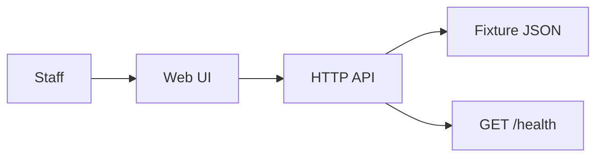
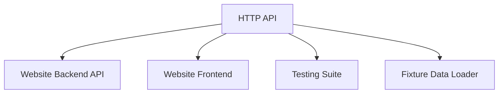
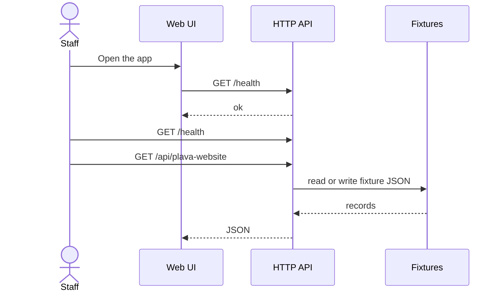

# KAN-1 — Plava Website

## Intent
Develop Website for Plava Consulting Ltd , based in Milton Keynes UK.  They are into IT consulting, developed and helping to develop several AI based tools

This file is the approved architecture. Code is written from this document. Revise it until you approve.

## System context

## Components

- **Website Backend API** (node) — Serve website content, handle API requests including health checks, and manage fixture data
- **Website Frontend** (node) — Render website pages, interact with backend APIs to display dynamic content
- **Testing Suite** (node) — Provide unit and integration tests for backend and frontend components
- **Fixture Data Loader** (python) — Load initial fixture data into the system for development and testing
- **Fixture store** — JSON under `fixtures/`. No production database.

## APIs

| Method | Path | Purpose |
| --- | --- | --- |
| GET | `/health` | Deploy verify — report ok |
| GET | `/api/plava-website` | Plava Website |

## Request flow

## Technologies
- Node.js
- Python
- React or similar frontend framework (to be decided)
- Express.js for backend API

After approval, this is implemented as a Node application. Allow-list: node, python. Packages: https://registry.npmjs.org, https://pypi.org. License: MIT.

## In scope
- Plava Website

## Out of scope
- Production data access
- Work outside this ticket
- A pull request unless auto-open is enabled

## Assumptions
- The website will be hosted on existing infrastructure or cloud platform not covered in this scope
- No custom AI tool development is required as part of this ticket
- Frontend framework choice will be finalized during design phase
- Security and compliance requirements will follow standard best practices

## Deploy
After lint, unit, and integration, and after deploy approval, pick Git and a cloud, then run the pipeline. Target **dev**. Rollback owner: **Platform on-call**.

## Planner notes
The website will be a single-page application (SPA) or multi-page website developed using Node.js for the backend API and Python for any server-side processing if needed. The frontend will consume backend APIs to display dynamic content. Health checks will be exposed via GET /health endpoint. Fixture data will be used to seed initial content. Linting, unit, and integration tests will be included to maintain code quality and reliability.

