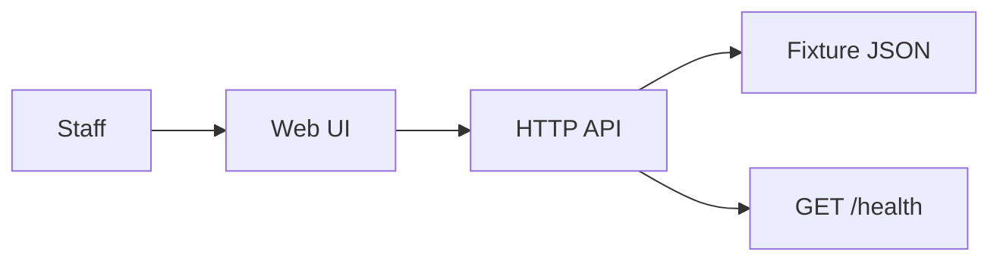
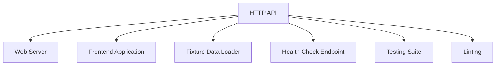
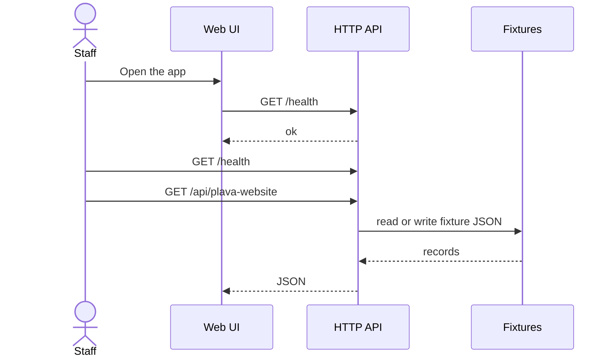

# KAN-1 — Plava Website

## Intent
Develop Website for Plava Consulting Ltd , based in Milton Keynes UK.  They are into IT consulting, developed and helping to develop several AI based tools

This file is the approved architecture. Code is written from this document. Revise it until you approve.

## Ticket comments
- Sesh A: KAN-1 is code review. Project folder written at C:\Users\SAI\visual-devops-platform-v2\data\delivery-workspaces\oaqYuipvbFnc using Azure OpenAI. Waiting for pull-request review.
- Sesh A: KAN-1 is deploy approval. Lint, unit, and integration passed. Waiting for deploy approval.
- Sesh A: KAN-1 is completed. Deploy is approved. I reused Git connection “Plavagit”. Open Connections, then Pipeline — attach that connection, set Infra to Use existing, and Run pipeline. Shipdeck will not create a new cloud until you choose.

## System context

## Components

- **Web Server** (node) — Serve frontend assets and backend REST APIs including health checks.
- **Frontend Application** (node) — Render the website UI and handle user interactions.
- **Fixture Data Loader** (node) — Load initial content data for the website.
- **Health Check Endpoint** (node) — Provide GET /health API to report service status.
- **Testing Suite** (node) — Provide unit and integration tests to ensure code quality.
- **Linting** (node) — Ensure code style and quality standards are met.
- **Fixture store** — JSON under `fixtures/`. No production database.

## APIs

| Method | Path | Purpose |
| --- | --- | --- |
| GET | `/health` | Deploy verify — report ok |
| GET | `/api/plava-website` | Plava Website |

## Request flow

## Technologies
- node
- express
- react
- jest
- eslint

After approval, this is implemented as a Node application. Allow-list: node, python. Packages: https://registry.npmjs.org, https://pypi.org. License: MIT.

## In scope
- Plava Website

## Out of scope
- Production data access
- Work outside this ticket
- A pull request unless auto-open is enabled

## Assumptions
- Node.js will be used as the primary language for both backend and frontend tooling.
- React or a similar Node.js-based frontend framework will be used for UI development.
- Basic branding and design assets will be provided later or created during development.
- Enterprise-level means adherence to common best practices in security, performance, and maintainability.
- The website will be hosted on a scalable cloud platform with standard deployment practices.

## Deploy
After lint, unit, and integration, and after deploy approval, pick Git and a cloud, then run the pipeline. Target **dev**. Rollback owner: **Platform on-call**.

## Revisions applied
1. I have a doubt can I see the Website and that should be the an enterprise level

## Planner notes
## Architecture Overview

The Plava website will be a modern, responsive web application built using Node.js for the backend and optionally React or similar for the frontend. The backend will expose RESTful APIs including a health check endpoint. Fixture data will be used to seed initial content. The application will follow best practices for linting, unit testing, and integration testing to ensure code quality and reliability.

### Components
- Web Server: Serves frontend and backend APIs.
- Content Management: Handles static and dynamic content using fixture data.
- Health Check API: GET /health endpoint to monitor service status.

### Deployment
The application will be containerized and deployed on a scalable platform (details TBD).

